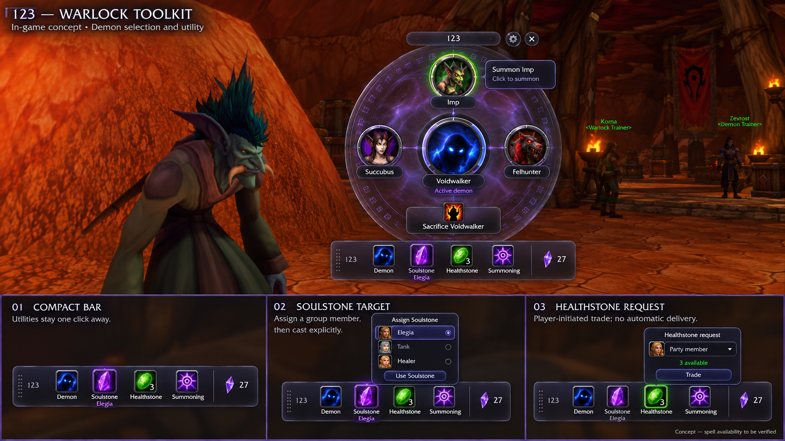

# 123 — Warlock Summons, Demons & Stones

A small glass bar for Warlocks on **WoW: Forever**: your demon, armor, soulstone, healthstones and
summoning, one click away. Plus the group chores: trade a healthstone to whoever asks, call for
summoning help, and a summon queue of everyone who typed **123**.

> Early development. The bar loads and shows; the features are being built. See the
> [issues](https://github.com/Spotnick2/123/issues).

## Commands
- `/123`: show or hide the bar (also `/onetwothree`, and a key binding)
- `/123 wheel`: open the demon wheel (also the bar's "Demons" button, and a key binding)
- Demon: summon your last demon; right-click: Demonic Sacrifice (once learned, with a demon out)
- Key bindings (Key Bindings > 123): the wheel, summon, Sacrifice-or-summon, Armor, Soulstone, Healthstone,
  Ritual of Summoning
- `/123 camera`: open the wheel with or without the cinematic camera and hidden UI
- `/123 labels`: show the names under the bar's icons (off: the tooltips say it)
- `/123 confirm`: ask (or stop asking) before re-summoning the demon that is out
- `/123 debug`: client build, load state and what each bar button is armed with

## Download
[CurseForge: forever-123](https://www.curseforge.com/wow/addons/forever-123) (project 1735903).

## Requirements
WoW: Forever (1.60.1). Uses [LibGlass-1.0](https://github.com/Spotnick2/LibGlass) and
[LibShowcase-1.0](https://github.com/Spotnick2/LibShowcase), embedded.

## Development
See `AGENTS.md`. Tests: `pwsh tests/run.ps1`. Deploy: `pwsh Tools/deploy.ps1 [-Probe]`.
