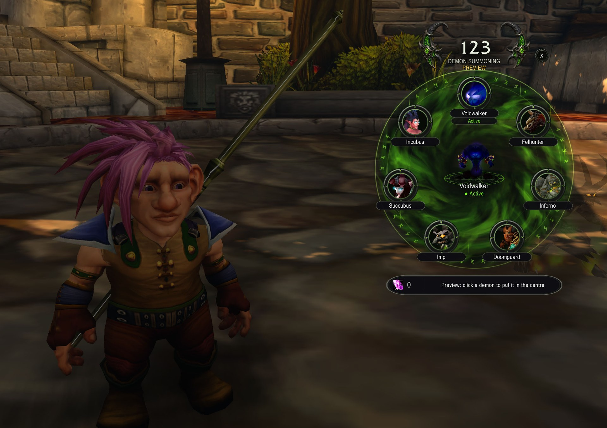
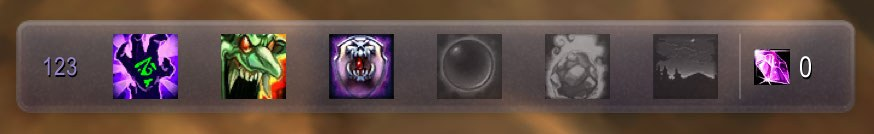
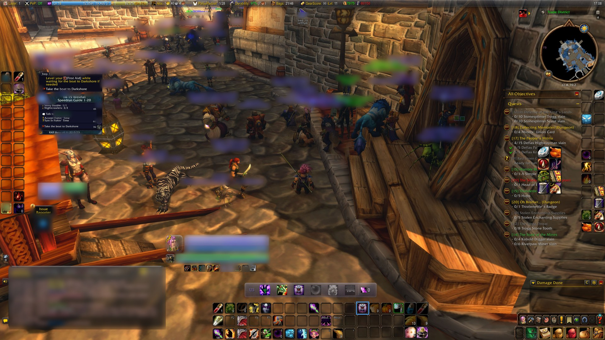
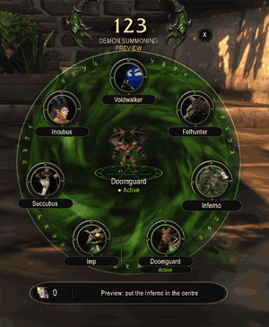
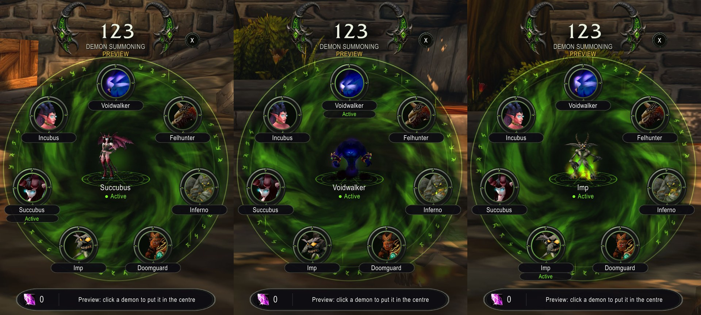

# 123 — Warlock Summons, Demons & Stones

A small glass bar and a fel demon wheel for Warlocks on **WoW: Forever**: your demons, armor,
soulstone, healthstones and summoning, one click away.

## The bar

**Demons** · **Demon** · **Armor** · **Soulstone** · **Healthstone** · **Summoning** | soul shards

- **Demons** opens the demon wheel.
- **Demon** summons your last demon (it asks before re-summoning the one that is out). Its
  right click is **Demonic Sacrifice** once you have the talent, so a Demonologist sacrifices
  from the bar.
- **Armor** casts your best armor (Demon Armor over Demon Skin, highest rank) and glows while
  it is not on you.
- **Soulstone / Healthstone** use the best stone you carry, or create the best one you know.
- **Summoning** is Ritual of Summoning.
- Out of Soul Shards, the Demon button falls back to the Imp and the buttons that would spend
  one grey out, until shards come back.
- Shift-drag the "123" handle to move it. Scale, names under the icons and the rest are in
  **Options > AddOns > 123** (or `/123 options`, or right-click the minimap button).

## The demon wheel

[The demon wheel in action, with sound (YouTube)](https://www.youtube.com/watch?v=IvxhJ4iC4Sc).

- Seven demons on a fel ring: Voidwalker, Felhunter, Inferno, Doomguard, Imp, Succubus and
  Forever's own **Incubus**, each a live animated portrait that speaks when you hover it.
- The demon that is out stands in the centre, in 3D.
- Click to summon, **shift-click** for Fel Domination first. **Right-click the centre** for
  Demonic Sacrifice (or the Voidwalker's own Sacrifice); the strip shows its effect.
- Reagents at a glance: "No Soul Shard", Infernal Stones and Demonic Figurines counted
  (free with the Reagent Economy perk).
- Opens with a cinematic camera and the game UI hidden (`/123 camera` to turn it off);
  Escape, a summon or combat closes it.
- `/123 preview` shows every demon without casting: click one to put it in the centre.

## Commands
- `/123`: show or hide the bar (also `/onetwothree`, and a key binding)
- `/123 options`: the options page (Options > AddOns > 123)
- `/123 wheel`: open the demon wheel (also the bar's "Demons" button, and a key binding)
- `/123 preview`: the wheel with every demon shown and nothing cast; click a demon to put it in
  the centre (screenshots, any level)
- `/123 camera`: open the wheel with or without the cinematic camera and hidden UI
- `/123 sounds`: the demons' voices on the wheel, on or off
- `/123 labels`: show the names under the bar's icons (off: the tooltips say it)
- `/123 confirm`: ask (or stop asking) before re-summoning the demon that is out
- `/123 debug`: client build, load state and what each bar button is armed with
- Minimap button: click for the demon wheel, shift-click to show or hide the bar, right-click for
  options (also in the Addon Compartment)
- Key bindings (Key Bindings > 123): the wheel, summon, Sacrifice-or-summon, Armor, Soulstone,
  Healthstone, Ritual of Summoning

## Coming next
Healthstone requests (a player-initiated trade when someone asks), a soulstone target, and the
summon queue: everyone who types **123** in group chat, with help calls for clickers. See the
[issues](https://github.com/Spotnick2/123/issues).

## Download
[CurseForge: forever-123](https://www.curseforge.com/wow/addons/forever-123) (project 1735903).

## Requirements
WoW: Forever (1.60.1), a Warlock (other classes get nothing). Uses
[LibGlass-1.0](https://github.com/Spotnick2/LibGlass) and
[LibShowcase-1.0](https://github.com/Spotnick2/LibShowcase), embedded, and LibDataBroker /
LibDBIcon for the minimap button.

## Development
See `AGENTS.md`. Tests: `pwsh tests/run.ps1`. Deploy: `pwsh Tools/deploy.ps1 [-Probe]`.
Screenshots: `python Tools/make_screenshots.py` (names blurred).
